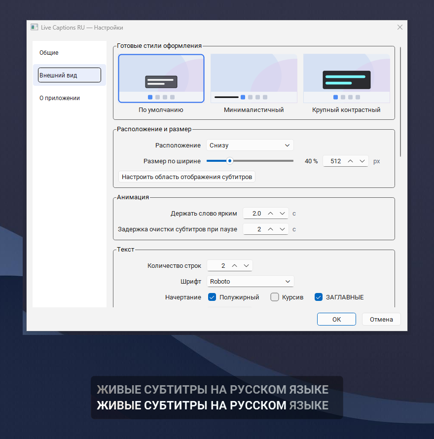

<div align="center">


<h1>Live Captions RU</h1>

<p><b>Real-time Russian captions for Windows. Local, offline, no telemetry, the audio never leaves the machine.</b></p>

<p>
  <a href="../../releases/latest"></a>
  <a href="https://pay.cloudtips.ru/p/318e1bac"></a>
</p>

<p>
  
  
  
  
</p>

<p>English | <a href="docs/README.ru.md">Русский</a></p>



</div>

The program listens to whatever the computer plays on its default output device,
recognises the speech locally and shows it as text in a floating subtitle box. It
works fully offline: no network access at runtime, no telemetry, and the audio
never leaves the machine.

Built for people who find it hard to follow speech, for example when the voice comes
through a headset all day in a support queue.

## Contents

- [What it does](#what-it-does)
- [Requirements](#requirements)
- [Install](#install)
- [First run](#first-run)
- [Control](#control)
- [Troubleshooting](#troubleshooting)
- [Privacy](#privacy)
- [Security](#security)
- [Build from source](#build-from-source)
- [How it works](#how-it-works)
- [Quality](#quality)
- [Tests](#tests)
- [Project layout](#project-layout)
- [FAQ](#faq)
- [Contributing](#contributing)
- [License](#license)
- [Support](#support)

## What it does

- Captures what the computer plays on the default output device (WASAPI loopback) and
  shows it as text in a floating subtitle box.
- Recognises Russian speech locally with the [T-one](https://github.com/voicekit-team/T-one)
  CTC model (71 M parameters, Apache 2.0) running on ONNX Runtime.
- Keeps three text levels: the previous phrase, the current phrase with the active word
  highlighted, and the not yet confirmed tail, each with its own transparency.
- The caption box is invisible to screen sharing and screenshots
  (`SetWindowDisplayAffinity`), never takes focus and stays on top.
- Settings are in Russian, apply live and preview the real overlay while you change them.

## Requirements

- Windows 10 version 1809 (build 17763) or newer, or Windows 11, 64-bit. Older systems
  (Windows 8.1, 7, XP) are not supported: the bundled Qt 6 build does not start there.
- Windows 10 version 2004 (build 19041) or newer to keep the captions out of screenshots
  and screen sharing. On older builds that protection is unavailable.
- 2 GB RAM minimum, 4 GB recommended. The app itself holds 310 to 380 MB of working set
  and about 590 MB of private commit over a 9 minute run with the fp32 model, so it fits
  a 2 GB machine next to Windows. The 1024 MB emergency valve only fires if the process
  runs away, roughly 2.7 times above the observed peak.
- Any output device. The app follows the system default and reconnects when the device
  changes.

## Install

Two packages are published in [Releases](../../releases):

- `LiveCaptionsRU-1.0.0-setup.exe` is the installer. It runs without administrator
  rights, copies the app to `%LOCALAPPDATA%\Programs\LiveCaptionsRU`, adds a Start menu
  shortcut and can add a desktop shortcut and autostart, both optional and off by
  default. The installer interface is in Russian.
- `LiveCaptionsRU-1.0.0-portable.zip` needs no installation: unpack it anywhere and run
  `LiveCaptionsRU.exe` from the unpacked folder. Keep the folder contents together,
  `_internal` holds the runtime and the speech model.

The speech model ships inside both packages, so the app never downloads anything at
runtime.

### Windows warnings about unsigned binaries

The executables are not code-signed, and Windows reacts to that in two different ways.

**SmartScreen** shows "Windows protected your PC" the first time you start the installer
or the portable build. Choose **More info**, then **Run anyway**. You can also clear the
mark-of-the-web before starting the app:

```powershell
Unblock-File .\LiveCaptionsRU-1.0.0-setup.exe
```

**Smart App Control** on Windows 11 is stricter: it blocks unknown and unsigned code by
default and offers no "Run anyway" button, so on such a machine the app does not start at
all. Check **Windows Security -> App & browser control -> Smart App Control**. Switching it
off affects every app on the machine, not just this one, so that decision stays with the
owner of the machine.

Some antivirus products also flag unsigned PyInstaller bundles as a packer heuristic.
There is no way around a heuristic other than signing, so the checksum described below is
the check that matters.

### Verifying the download

`SHA256SUMS.txt` in the release lists the checksum of every asset. Check a downloaded
file before running it:

```powershell
Get-FileHash .\LiveCaptionsRU-1.0.0-setup.exe -Algorithm SHA256
```

or with `certutil -hashfile LiveCaptionsRU-1.0.0-setup.exe SHA256`. The output has to
match the line in `SHA256SUMS.txt` character for character. The checksum file is
published next to the binaries, so it confirms the download completed without
corruption, not that the release itself is genuine: without a code signing certificate
there is nothing that proves authorship of the binaries.

## First run

1. Start the app. A tray icon appears and captions are shown.
2. Play any speech on the default output device. Text appears in the subtitle box.
3. Open **Настройки** from the tray menu to move the box, change its width, fonts,
   transparency or the number of lines. Changes are previewed immediately.

Settings are stored in `%LOCALAPPDATA%\LiveCaptionsRU\settings.json`, the log in
`%LOCALAPPDATA%\LiveCaptionsRU\app.log` (rotated at 1 MB, three files kept).

## Control

Everything lives in the tray icon menu: **Включить/Выключить субтитры**, **Настройки**
and **Выход**. Global hotkeys are deliberately not used, the program must not take
system key combinations away from other applications.

The settings dialog has three sections: **General** (autostart, device and monitor,
service actions), **Appearance** (position and width, animation, text, transparency,
outline, backdrop) and **About**. **OK** applies and saves, **Cancel** restores the
previous values.

Uninstalling removes the program and the log. `settings.json` survives an uninstall on
purpose, because the box position and the look are the user's work.

## Troubleshooting

**SmartScreen blocks the installer.** The binary is not signed. Choose **More info**,
then **Run anyway**, and check the SHA-256 first as described above.

**No text appears.** The app listens to the default output device, not to a microphone.
Check that the sound is actually playing on that device, and that the app is enabled in
the tray menu. If the device changes while the app runs, it reconnects on its own.

**The caption box is visible in a screenshot or in a shared screen.** This protection
needs Windows 10 version 2004 or newer. On older builds the box is a normal window.

**Memory grows or the captions stall.** The app watches itself: after 60 seconds of
sound without text it restarts the recognition pipeline, and above 1024 MB of working
set it relaunches itself. Both events are written to the log.

**Something else.** Open the log with **Открыть журнал событий** in the settings dialog
and attach it to an issue. The log records starts, stops, device changes, settings
changes and errors, and never the recognised text.

## Privacy

- No network access at runtime, no telemetry, no crash reporting.
- Settings and logs stay on the machine, in `%LOCALAPPDATA%\LiveCaptionsRU\`.
- The log records starts, stops, device changes, settings changes and errors only. The
  recognised text is not stored anywhere: it is drawn in the overlay and dropped.
- The model files are checked against the published SHA-256 on every start, and a
  mismatch is written to the log.

The program captures the sound of the machine, which can include other people's speech.
Recording conversations may have legal consequences where you live, so check the local
rules before using it with third parties.

## Security

- The current version is 1.0.0. Only the latest release gets fixes.
- Report a vulnerability through the private channel described in
  [SECURITY.md](.github/SECURITY.md), not in a public issue.
- The model files and the release assets are covered by SHA-256 checksums;
  `tools/verify_model.py` reproduces the model check.

## Build from source

```powershell
python -m venv .venv
.venv\Scripts\activate
pip install -r requirements.txt
pip install -r requirements-dev.txt   # PyInstaller, Pillow, pytest, ruff
python tools\verify_model.py          # checks models\t-one against the release hashes
python app\main.py                    # run from sources
python tools\build.py --clean         # build dist\LiveCaptionsRU (onedir)

# the installer needs Inno Setup 6.3 or newer:
iscc installer\LiveCaptionsRU.iss     # dist-installer\LiveCaptionsRU-<version>-setup.exe
```

`tools/build.py --onefile` produces a single executable instead; it starts slower
because the bundle is unpacked into a temporary folder on every launch.

The model is not stored in the repository: GitHub blocks files above 100 MiB in a regular
git push, while release assets allow up to 2 GiB each, so the model ships inside the release
archives only. To build from source, put the fp32 export described in
[`models/README.md`](models/README.md) into `models/t-one` and confirm it with
`tools/verify_model.py`. The upstream quantized file is smaller and useful for tests, but it
is a different file and does not produce byte-identical output.

## How it works

```
output device -> loopback capture -> 300 ms chunks -> T-one ONNX -> CTC decoder -> overlay
```

- **Capture** uses `soundcard` in loopback mode, follows the default device and reopens
  the stream when the device changes.
- **Recognition** feeds 300 ms chunks (8 kHz) into the model together with its recurrent
  state. The decoder is part of this project on purpose: the sherpa-onnx Python runtime
  leaked about 3 to 4 KB per text read in its `get_result` path (around 210 MB per hour).
- **Phrase history** keeps the last completed phrases for the top line.
- **Rendering** wraps words, trims the beginning of an overlong line (the end of a phrase
  matters more) and paints outline and backdrop.

On a laptop CPU with two threads the real-time factor is about 0.08, roughly ten times
faster than real time, with a flat memory profile.

## Quality

Measured on a laptop CPU with the bundled fp32 model, two threads:

- real-time factor 0.075, about 13 times faster than real time;
- process memory 359 to 362 MB over a 254 second continuous run, no growth;
- no glued words, no double spaces, no stray characters in the decoded text;
- idle CPU 10 to 11 percent of one core on a silent input, down from 74.7 percent before
  the energy gate. Chunks that cannot carry speech never reach the model; the remainder
  is audio capture and resampling. With the gate switched off the decoded text is
  identical on 6 of the 8 speech files of the gate set (clean, -12/-20/-28 dB, SNR
  15/8/3 dB, 1.5x speed, quiet); on the two quietest ones, -34 dB and -40 dB, where the
  gate drops 3.4 and 4.4 percent of chunks, 4 and 7 characters out of about 1600 differ,
  character error rate 0.0025 and 0.0046 against the run without the gate;
- the model itself, not the gate, is what suffers at 2x speed: character error rate 0.78
  against the clean reference on `speech_fast_2x.wav`. 1.5x stays at 0.12;
- word error rate 16.4 percent on 200 clips from Golos crowd (read speech, many clips are
  one or two words); 13.7 percent on phrases from five words; 18.4 percent when the same
  clips go through a 300 to 3400 Hz telephone band with 20 dB of noise. Greedy decoding
  without a language model is the main reason the published 6 to 8 percent is not
  reached.

## Tests

The scripts under `tests/` are end-to-end checks: they create real Qt widgets, render the
overlay, start the worker and compare output. Run them one by one on a desktop session:

```powershell
python tests\verify_v5.py      # appearance, transparency, backdrop
python tests\verify_v7.py      # preview text and segments
python tests\verify_v10.py     # decoder, endpointing, memory (needs the model)
pytest tests\test_mutex.py     # single-instance guard
```

`verify_v10.py` needs `models\t-one\model.onnx`; the rest work without it.

The offline gates take their paths from the environment, so they work outside this
checkout: `LCRU_MODEL_DIR` (default `models/t-one`), `LCRU_GATE_SET` (default
`%TEMP%\gate_set`), `LCRU_GATE_SRC` (a clean 8 kHz mono recording for
`make_gate_set.py`), `LCRU_MAX_CER` (default 0.35). `tests/gate_eval.py` exits with code
1 when a speech file decodes worse than that threshold and code 2 when the model or the
set is missing, so it can be wired into a check instead of being read by eye.

## Project layout

```
app/                application code
  main.py           entry point, tray, pipeline wiring
  asr.py            T-one inference, model checksum check, CTC decoder
  capture.py        loopback capture with reconnect
  overlay.py        caption window, layout and edit mode
  settings_dialog.py, widgets_ui.py, color_dialog.py, theme
  settings.py       settings model, validation and migrations
  paths.py          folders, autostart, logging setup
tests/              verification scripts (Qt based, run on a real desktop)
tools/              build and model check helpers
assets/             icon and installer artwork
docs/               Russian manual
installer/          Inno Setup script
licenses/           third-party license texts
```

## FAQ

**Does it need internet?** No. Nothing is downloaded, uploaded or reported at runtime.

**Which languages are supported?** Russian only. The model is Russian-specific and the
interface is Russian.

**Windows only?** Yes. The capture path and the screenshot protection are Win32 APIs.

**Why are the captions missing from my stream and from screenshots?** That is the point
of the `SetWindowDisplayAffinity` call: the box is meant for your eyes only. It needs
Windows 10 version 2004 or newer.

**Can I copy the recognised text?** Not in 1.0.0. The text is drawn in the overlay and
not stored, so there is nothing to copy after the fact.

**Can I use my own model?** Yes. Put a different export into `models\t-one` next to the
executable; the app takes that folder over the bundled copy. The start-up check will
log `model_verify_mismatch`, which is expected in that case.

**Why is the installer in Russian while the repository is in English?** The product is
for Russian speech, so the interface is Russian. The sources and the documentation are
in English for review.

## Contributing

Issues and pull requests are welcome. Before sending a patch:

- keep the code comments minimal and in English;
- run the checks that touch your change (`python tests\verify_v5.py` for the overlay,
  `pytest tests\test_mutex.py` for the single-instance guard);
- do not add network calls or telemetry, the offline promise is part of the product;
- keep the interface strings in Russian.

## License

Apache License 2.0, see [LICENSE](LICENSE) and [NOTICE](NOTICE). Third-party components
and their licenses are listed in [THIRD-PARTY-NOTICES.md](THIRD-PARTY-NOTICES.md).

The T-one model is distributed under Apache 2.0 by T-Bank / T-Software DC and was
converted to ONNX by the sherpa-onnx project. Roboto is distributed under Apache 2.0 by
Google. This project is not affiliated with either of them.

## Support

The app is free and stays free. If it is useful to you, you can leave a tip:

[pay.cloudtips.ru/p/318e1bac](https://pay.cloudtips.ru/p/318e1bac)

Author: **600D R3450N**, [github.com/600dr3450n](https://github.com/600dr3450n)
