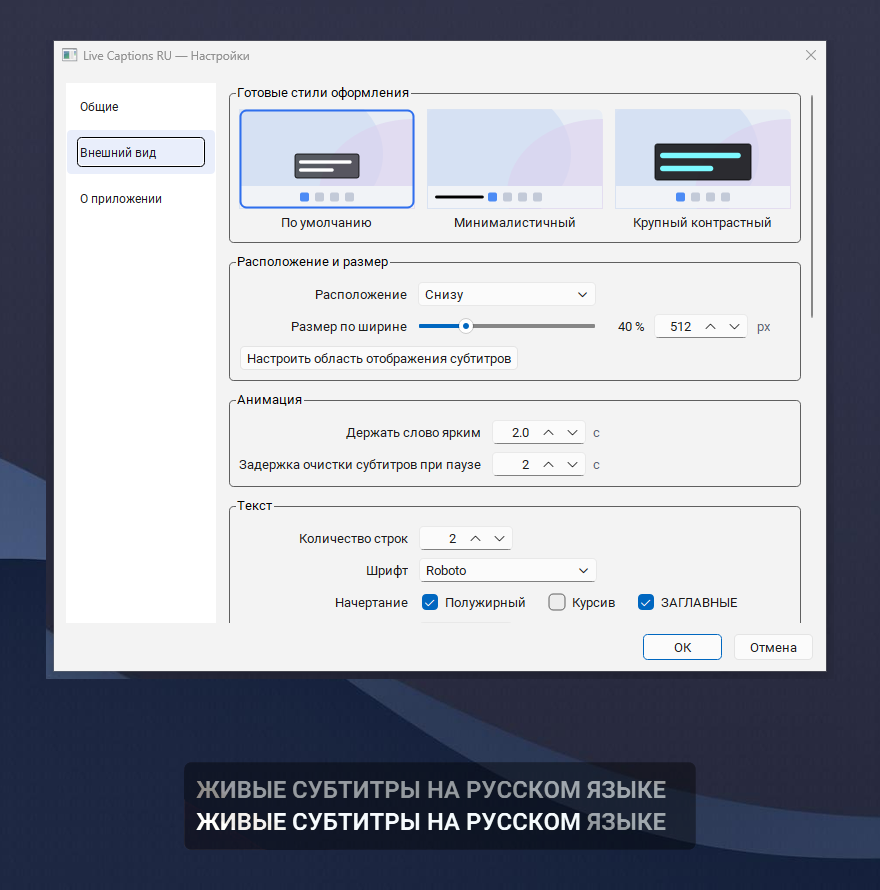

<div align="center">


<h1>Live Captions RU</h1>

<p><b>Живые субтитры на русском в Windows. Локально, офлайн, без телеметрии, звук не покидает машину.</b></p>

<p>
  <a href="../../../releases/latest"></a>
  <a href="https://pay.cloudtips.ru/p/318e1bac"></a>
</p>

<p>
  
  
  
  
</p>

<p><a href="../README.md">English</a> | Русский</p>



</div>

Программа слушает то, что компьютер выводит на устройство по умолчанию, распознает
речь локально и показывает ее текстом в плашке поверх остальных окон. Работает
полностью офлайн: во время работы нет обращений к сети, нет телеметрии, звук не
покидает машину.

Сделана для тех, кому трудно разбирать речь на слух, например когда голос весь день идет
в наушники на линии поддержки.

## Содержание

- [Что делает программа](#что-делает-программа)
- [Требования](#требования)
- [Установка](#установка)
- [Первый запуск](#первый-запуск)
- [Управление](#управление)
- [Если что-то не работает](#если-что-то-не-работает)
- [Приватность](#приватность)
- [Безопасность](#безопасность)
- [Сборка из исходников](#сборка-из-исходников)
- [Как это устроено](#как-это-устроено)
- [Качество](#качество)
- [Тесты](#тесты)
- [Структура проекта](#структура-проекта)
- [Частые вопросы](#частые-вопросы)
- [Участие в разработке](#участие-в-разработке)
- [Лицензия](#лицензия)
- [Поддержка](#поддержка)

## Что делает программа

- Захватывает звук, который компьютер выводит на устройство по умолчанию (WASAPI
  loopback), и показывает его текстом в плашке субтитров.
- Распознает русскую речь локально моделью [T-one](https://github.com/voicekit-team/T-one)
  (CTC, 71 млн параметров, Apache 2.0) на ONNX Runtime.
- Показывает текст в три слоя: прошлая фраза, текущая фраза с подсвеченным активным
  словом и хвост, который еще не подтвержден. Прозрачность у каждого слоя своя.
- Плашку не видно на скриншотах и в демонстрации экрана (`SetWindowDisplayAffinity`),
  фокус она никогда не забирает и остается поверх других окон.
- Настройки на русском, применяются на ходу, и в них сразу видно, как будет выглядеть
  настоящая плашка.

## Требования

- Windows 10 версии 1809 (сборка 17763) или новее либо Windows 11, 64 бита. На более
  старых системах (Windows 8.1, 7, XP) программа не пойдет: входящая в комплект сборка
  Qt 6 там не запускается.
- Windows 10 версии 2004 (сборка 19041) или новее, иначе субтитры попадут на скриншоты и
  в демонстрацию экрана. На более старых сборках такой защиты нет.
- Память: от 2 ГБ, лучше 4 ГБ. За 9 минут непрерывной работы с моделью fp32 программа
  держит 310-380 МБ рабочего набора (working set) и около 590 МБ выделенной памяти
  (private commit), поэтому на машине с 2 ГБ она уживается с Windows. Предохранитель на
  1024 МБ срабатывает, только если процесс пойдет вразнос, это примерно в 2,7 раза выше
  самого большого пика, который мы видели.
- Любое устройство вывода. Программа идет за системным устройством по умолчанию и
  переподключается, когда оно меняется.

## Установка

В разделе [Releases](../../../releases) лежат два пакета:

- `LiveCaptionsRU-1.0.0-setup.exe` - установщик. Права администратора не нужны, программа
  копируется в `%LOCALAPPDATA%\Programs\LiveCaptionsRU`, в меню "Пуск" появляется ярлык.
  Ярлык на рабочем столе и автозапуск включаются по желанию, оба пункта по умолчанию
  выключены. Интерфейс установщика на русском.
- `LiveCaptionsRU-1.0.0-portable.zip` - установка не нужна: распакуйте в любую папку и
  запустите `LiveCaptionsRU.exe` оттуда. Файлы папки должны лежать вместе, в `_internal`
  находятся рантайм и модель распознавания.

Модель распознавания входит в оба пакета, поэтому во время работы программа ничего не
скачивает.

### Предупреждения Windows о неподписанных файлах

Файлы не подписаны кодом, и Windows реагирует на это двумя разными способами.

**SmartScreen** при первом запуске установщика или портативной сборки показывает "Система
Windows защитила ваш компьютер". Нажмите **Подробнее**, затем **Выполнить в любом
случае**. Метку "скачано из интернета" можно снять еще до запуска:

```powershell
Unblock-File .\LiveCaptionsRU-1.0.0-setup.exe
```

**Smart App Control** в Windows 11 строже: он по умолчанию блокирует незнакомый и
неподписанный код, кнопки "Выполнить в любом случае" не предлагает, и на такой машине
программа просто не стартует. Смотреть в **Безопасность Windows -> Управление приложениями
и браузером**, раздел про интеллектуальное управление приложениями (Smart App Control): в
разных сборках он подписан чуть иначе. Отключение затронет все программы на машине, а не
только эту, поэтому решать владельцу машины.

Некоторые антивирусы вдобавок считают неподписанные сборки PyInstaller подозрительными по
эвристике упаковщика. Обойти эвристику без подписи нельзя, поэтому главная проверка -
контрольная сумма, о ней ниже.

### Проверка скачанного файла

В релизе лежит `SHA256SUMS.txt` с суммой каждого файла. Проверьте скачанное до запуска:

```powershell
Get-FileHash .\LiveCaptionsRU-1.0.0-setup.exe -Algorithm SHA256
```

или через `certutil -hashfile LiveCaptionsRU-1.0.0-setup.exe SHA256`. Вывод должен
совпасть со строкой в `SHA256SUMS.txt` символ в символ. Файл с суммами лежит рядом с
бинарниками, поэтому он подтверждает, что скачивание прошло без повреждений, а не
подлинность релиза: без сертификата подписи кода доказывать авторство бинарников нечем.

## Первый запуск

1. Запустите программу. В трее появится значок, субтитры включены.
2. Включите любую речь на устройстве вывода по умолчанию. Текст появится в плашке.
3. Откройте **Настройки** в меню трея, чтобы сдвинуть плашку, поменять ширину, шрифты,
   прозрачность или число строк. Результат видно сразу.

Настройки лежат в `%LOCALAPPDATA%\LiveCaptionsRU\settings.json`, журнал - в
`%LOCALAPPDATA%\LiveCaptionsRU\app.log` (прокручивается на 1 МБ, хранятся три файла).

## Управление

Все в меню значка в трее: **Включить/Выключить субтитры**, **Настройки** и **Выход**.
Глобальные горячие клавиши намеренно не используются: программа не должна отбирать у
других приложений системные сочетания.

В диалоге настроек три раздела: **Общие** (автозапуск, устройство и монитор, служебные
действия), **Внешний вид** (положение и ширина, анимация, текст, прозрачность, обводка,
подложка) и **О приложении**. **ОК** применяет и сохраняет, **Отмена** возвращает прежние
значения.

При удалении уходят программа и журнал. `settings.json` остается специально: положение
плашки и внешний вид - это работа пользователя.

## Если что-то не работает

**SmartScreen не дает запустить установщик.** Файл не подписан. Нажмите **Подробнее**,
затем **Выполнить в любом случае**, а до этого сверьте SHA-256, как описано выше.

**Текста нет.** Программа слушает устройство вывода по умолчанию, а не микрофон.
Проверьте, что звук идет именно на это устройство и что субтитры включены в меню трея.
Если устройство поменялось на ходу, программа переподключится сама.

**Плашку видно на скриншоте или в демонстрации экрана.** Для этой защиты нужна Windows 10
версии 2004 или новее. На более старых сборках плашка - обычное окно.

**Растет память или субтитры замирают.** Программа следит за собой: после 60 секунд звука
без текста она перезапускает распознавание, а выше 1024 МБ рабочего набора перезапускает
себя. Оба события пишутся в журнал.

**Что-то другое.** Откройте журнал кнопкой **Открыть журнал событий** в настройках и
приложите его к задаче. Журнал пишет запуски, остановки, смену устройства, изменения
настроек и ошибки, распознанный текст в него не попадает.

## Приватность

- Во время работы нет обращений к сети, нет телеметрии, нет отчетов о падениях.
- Настройки и журналы остаются на машине, в `%LOCALAPPDATA%\LiveCaptionsRU\`.
- Журнал пишет только запуски, остановки, смену устройства, изменения настроек и ошибки.
  Распознанный текст нигде не хранится: он рисуется в плашке и выбрасывается.
- Файлы модели сверяются с опубликованным SHA-256 при каждом запуске, несовпадение
  попадает в журнал.

Программа захватывает звук машины, а в нем бывает речь других людей. Запись разговоров в
некоторых странах имеет правовые последствия, поэтому прежде чем включать программу при
третьих лицах, проверьте местные правила.

## Безопасность

- Текущая версия 1.0.0. Исправления получает только последний релиз.
- Об уязвимости сообщайте по закрытому каналу из
  [SECURITY.md](../.github/SECURITY.md), а не в публичной задаче.
- Файлы модели и файлы релиза покрыты контрольными суммами SHA-256;
  `tools/verify_model.py` повторяет проверку модели.

## Сборка из исходников

```powershell
python -m venv .venv
.venv\Scripts\activate
pip install -r requirements.txt
pip install -r requirements-dev.txt   # PyInstaller, Pillow, pytest, ruff
python tools\verify_model.py          # сверяет models\t-one с хешами релиза
python app\main.py                    # запуск из исходников
python tools\build.py --clean         # сборка dist\LiveCaptionsRU (onedir)

# для установщика нужен Inno Setup 6.3 или новее:
iscc installer\LiveCaptionsRU.iss     # dist-installer\LiveCaptionsRU-<version>-setup.exe
```

`tools/build.py --onefile` соберет один исполняемый файл. Запускается он медленнее, потому
что каждый раз распаковывает себя во временную папку.

Модели в репозитории нет: GitHub не принимает файлы больше 100 МиБ при обычном git push, а
файлы релиза тянут до 2 ГиБ каждый, поэтому модель лежит только внутри архивов релиза. Для
сборки из исходников положите экспорт fp32, описанный в [`models/README.md`](../models/README.md),
в `models/t-one` и проверьте его через `tools/verify_model.py`. Исходный квантованный файл
меньше и годится для тестов, но это другой файл, и байт в байт с релизом он не совпадет.

## Как это устроено

```
output device -> loopback capture -> 300 ms chunks -> T-one ONNX -> CTC decoder -> overlay
```

- **Захват** работает через `soundcard` в режиме loopback, идет за устройством по
  умолчанию и открывает поток заново, когда устройство меняется.
- **Распознавание** подает в модель куски по 300 мс (8 кГц) вместе с ее рекуррентным
  состоянием. Декодер написан внутри проекта намеренно: рантайм sherpa-onnx для Python
  терял 3-4 КБ на каждое чтение текста в `get_result`, это около 210 МБ в час.
- **История фраз** хранит последние законченные фразы для верхней строки.
- **Отрисовка** переносит слова, подрезает начало слишком длинной строки (конец фразы
  важнее) и рисует обводку с подложкой.

На процессоре ноутбука в два потока коэффициент реального времени около 0,08, то есть
примерно в десять раз быстрее реального времени, и память при этом не растет.

## Качество

Замеры на процессоре ноутбука с моделью fp32 из комплекта, два потока:

- коэффициент реального времени 0,075, примерно в 13 раз быстрее реального времени;
- память процесса 359-362 МБ за 254 секунды непрерывной работы, роста нет;
- в распознанном тексте нет слипшихся слов, двойных пробелов и мусорных символов;
- процессор в простое 10-11% одного ядра на тишине, до энергетического порога
  было 74,7%. Куски, в которых речи быть не может, до модели не доходят, остальное - это
  захват звука и пересчет частоты. При выключенном пороге распознанный текст совпадает на
  6 из 8 речевых файлов набора (чистый, -12/-20/-28 дБ, отношение сигнал/шум 15/8/3 дБ,
  скорость 1,5x, тихий); на двух самых тихих, -34 и -40 дБ, где порог отбрасывает 3,4 и
  4,4% кусков, расходятся 4 и 7 символов из примерно 1600, то есть доля ошибок по
  символам 0,0025 и 0,0046 против прогона без порога;
- на скорости 2x страдает сама модель, а не порог: доля ошибок по символам 0,78 против
  чистого эталона на `speech_fast_2x.wav`. На 1,5x держится 0,12;
- доля ошибок по словам 16,4% на 200 записях из Golos crowd (чтение, многие записи по
  одному-два слова), 13,7% на фразах от пяти слов, 18,4%, если те же записи прогнать через
  телефонную полосу 300-3400 Гц с шумом 20 дБ. Опубликованные 6-8% не достигаются в
  основном из-за жадного декодирования без языковой модели.

## Тесты

Скрипты в `tests/` проверяют все целиком: создают настоящие виджеты Qt, рисуют плашку,
запускают воркер и сравнивают результат. Запускайте их по одному на живом рабочем столе:

```powershell
python tests\verify_v5.py      # внешний вид, прозрачность, подложка
python tests\verify_v7.py      # текст превью и сегменты
python tests\verify_v10.py     # декодер, определение конца фразы, память (нужна модель)
pytest tests\test_mutex.py     # защита от второго экземпляра
```

`verify_v10.py` нужен `models\t-one\model.onnx`, остальным модель не требуется.

Офлайновые проверки берут пути из окружения, поэтому работают и вне этого каталога:
`LCRU_MODEL_DIR` (по умолчанию `models/t-one`), `LCRU_GATE_SET` (по умолчанию
`%TEMP%\gate_set`), `LCRU_GATE_SRC` (чистая моно-запись 8 кГц для `make_gate_set.py`),
`LCRU_MAX_CER` (по умолчанию 0.35). `tests/gate_eval.py` завершается с кодом 1, когда
речевой файл распознан хуже порога, и с кодом 2, когда нет модели или набора, поэтому его
можно ставить в автоматическую проверку, а не читать глазами.

## Структура проекта

```
app/                код приложения
  main.py           точка входа, трей, сборка конвейера
  asr.py            инференс T-one, сверка контрольной суммы модели, декодер CTC
  capture.py        захват loopback с переподключением
  overlay.py        окно субтитров, раскладка и режим правки
  settings_dialog.py, widgets_ui.py, color_dialog.py, тема
  settings.py       модель настроек, проверка и миграции
  paths.py          папки, автозапуск, настройка журнала
tests/              скрипты проверки (на Qt, запускаются на живом рабочем столе)
tools/              сборка и проверка модели
assets/             значок и графика установщика
docs/               русская инструкция
installer/          скрипт Inno Setup
licenses/           тексты лицензий третьих сторон
```

## Частые вопросы

**Нужен ли интернет?** Нет. Во время работы ничего не скачивается, не отправляется и не
передается.

**Какие языки поддерживаются?** Только русский. Модель русскоязычная, интерфейс тоже.

**Только Windows?** Да. И захват звука, и защита от скриншотов - это Win32 API.

**Почему субтитров нет в моей трансляции и на скриншотах?** В этом и смысл вызова
`SetWindowDisplayAffinity`: плашка сделана только для ваших глаз. Нужна Windows 10 версии
2004 или новее.

**Можно скопировать распознанный текст?** В 1.0.0 нельзя. Текст рисуется в плашке и не
сохраняется, копировать после него нечего.

**Можно подключить свою модель?** Да. Положите другой экспорт в `models\t-one` рядом с
исполняемым файлом, программа возьмет эту папку вместо встроенной копии. Проверка при
старте напишет в журнал `model_verify_mismatch`, в этом случае так и должно быть.

**Почему установщик на русском, а репозиторий на английском?** Продукт для русской речи,
поэтому интерфейс русский. Исходники и документация на английском, чтобы их можно было
читать со стороны.

## Участие в разработке

Задачи и пул-реквесты приветствуются. Перед отправкой правки:

- комментарии в коде держите короткими и на английском;
- прогоните проверки, которых касается правка (`python tests\verify_v5.py` для плашки,
  `pytest tests\test_mutex.py` для защиты от второго экземпляра);
- не добавляйте обращения к сети и телеметрию, обещание офлайна - часть продукта;
- строки интерфейса держите на русском.

## Лицензия

Apache License 2.0, смотрите [LICENSE](../LICENSE) и [NOTICE](../NOTICE). Сторонние
компоненты и их лицензии перечислены в
[THIRD-PARTY-NOTICES.md](../THIRD-PARTY-NOTICES.md).

Модель T-one распространяется под Apache 2.0 от T-Банка / T-Software DC и переведена в
ONNX проектом sherpa-onnx. Roboto распространяется под Apache 2.0 от Google. Этот проект
не связан ни с теми, ни с другими.

## Поддержка

Программа бесплатная и останется бесплатной. Если она пригодилась, можно оставить чаевые:

[pay.cloudtips.ru/p/318e1bac](https://pay.cloudtips.ru/p/318e1bac)

Автор: **600D R3450N**, [github.com/600dr3450n](https://github.com/600dr3450n)
